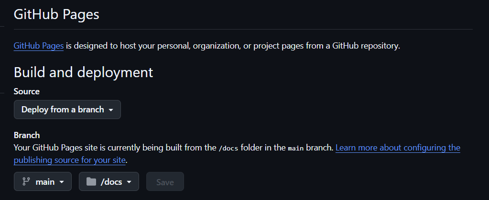

# HSMA Quarto Slide Template

This provides a starting point for making HSMA slides using the Quarto platform.

Make your changes to the `slides.qmd` file.

Then run `quarto render --output-dir docs` (always pass `--output-dir` explicitly -- see "Publishing, and the docs/ folder" below for why).

The final output can be hosted on Github Pages.

The output of `slides.qmd` is set to automatically be `docs/index.html`, so point your github pages site to the docs folder.



## Setting up the Python environment

The deck executes Python code cells, so Quarto needs a Python environment with Jupyter available. Dependencies are declared in `pyproject.toml` and pinned in `uv.lock`, managed with [uv](https://docs.astral.sh/uv/).

```bash
uv sync
```

That creates a `.venv` in the project folder with everything needed: the Jupyter stack that executes the code cells, `pyyaml` for the docs cleanup hook, and `plotly`/`pandas` for the example cells that actually run at render time. Then render with:

```bash
uv run quarto render --output-dir docs
```

### If the render can't find your packages

Quarto picks its own Python interpreter, and if it picks the wrong one you'll get errors like `ModuleNotFoundError: No module named 'nbformat'` or a plotly complaint about missing numpy/pandas — even though `uv sync` installed them. Two causes worth knowing:

- **A different environment is already active.** If you have a conda env or another venv activated, `VIRTUAL_ENV` points at it and Quarto will use that instead of `.venv`. `uv` warns about this (`does not match the project environment path .venv`). Deactivate it, or open a fresh terminal, before rendering.
- **Quarto isn't finding `.venv` at all.** Point it at the interpreter explicitly:

  ```bash
  export QUARTO_PYTHON="$PWD/.venv/Scripts/python.exe"   # Windows
  export QUARTO_PYTHON="$PWD/.venv/bin/python"           # macOS / Linux
  ```

Rendering from VS Code's Quarto preview generally picks up the project `.venv` on its own.

Note that only `{python}` cells marked `eval: true` run at render time. Code in `{pyodide}` and `{stlite-python}` cells (matplotlib, numpy, streamlit) runs in the reader's browser, so those packages don't need to be installed locally.

## Notes

After making any changes to the *custom.scss* file (or *title-slide.scss*), close any quarto preview windows and/or terminals you have open, then start the preview from scratch. Updates will not be pulled through when saving the updated file or re-clicking on preview, even if the page appears to reload.

## Publishing, and the docs/ folder

`docs/` is the GitHub Pages source, so **it must be committed** — never add it to `.gitignore`. If you do, every render produces new content-hashed filenames that `git add -A` silently skips, and you end up needing `git add -f` forever.

Quarto's default (non-website) project type copies the **entire project directory** into `docs/` on every render, and it ignores `.gitignore`. Left alone, `docs/` fills up with your source files, `data/` folders, `__pycache__/`, lockfiles and multi-megabyte Jupyter intermediates — all of which get published. `_docs_cleanup.py`, wired in as a `post-render` hook in `_quarto.yml`, is what stops that: after each render it deletes everything in `docs/` that isn't on the `docs-keep` allowlist.

To customise it for your deck, **edit the `docs-keep:` list in `_quarto.yml`, not the Python**. Add any folder your deck links to at runtime (extra images, PDFs, data files, handouts). If you drop something the deck actually needs, the deck breaks silently on the published site — so open `docs/index.html` and click through after changing the list.

Also in `_quarto.yml`, the `render:` list names the deck's entry file. If you rename `slides.qmd`, update it to match.

**Always render with `quarto render --output-dir docs` (not bare `quarto render`), and don't add `output-dir` to `_quarto.yml`.** Setting it in the YAML instead of the command line breaks `quarto preview` of a single ad-hoc file not in `render:` — e.g. previewing one `_SECTION_*.qmd` on its own (see "Fast iteration on a single section" below): Quarto anchors the preview server at `output-dir` even though the previewed file's own output still lands at the project root, so the browser gets a broken 404. See `_docs_cleanup.py`'s docstring for the full explanation.

### Troubleshooting

**`docs/` is still full of junk after a render.** Check for a leftover `quarto preview` process first — a background watcher will keep re-triggering the full-directory copy on every file save, independent of the cleanup hook, and it looks exactly like the fix not working. On Windows: `tasklist | findstr /i "quarto deno"`. Elsewhere: `ps aux | grep quarto`.

**`.quartoignore` doesn't help.** It only applies to `quarto use template` scaffolding and has no effect on `quarto render`.

**The cleanup did nothing and printed a warning.** That's deliberate — if `docs-keep` is missing or empty, the script refuses to guess what's safe to delete rather than emptying your output folder.

## Fast iteration on a single section

Shared format/theme/plugin config lives in `_metadata.yml`, which Quarto
merges into every document in the project -- so a single section can be
rendered/previewed standalone with the full live-revealjs styling, without
duplicating the header and without rebuilding the whole deck. Both of these
work (including the VS Code "Preview" button/CodeLens, which runs the bare
form):

```
quarto preview _SECTION_foo.qmd
quarto preview _SECTION_foo.qmd --output-dir _preview
```

The bare form renders next to the source at the project root (gitignored:
`_SECTION_*.html`, `_SECTION_*/*`). `--output-dir _preview` (also
gitignored) tidies that away into one folder if you'd rather. Either way,
never pass `--output-dir docs` for a section preview -- that's the real
published output, and the post-render cleanup hook runs against whatever
`--output-dir` you point it at.

Splitting a deck's content into `_SECTION_*.qmd` files also lets multiple
decks share the same pool of sections: give each deck its own `slides_*.qmd`
(only `title`/`subtitle`/`author`/deck-specific front matter -- no
`output-dir` key, see above), then `` the subset of sections
it needs. Give the extra deck its own `_quarto-<name>.yml` project profile
(https://quarto.org/docs/projects/profiles.html) overriding `project.render`
(and its own `docs-keep`, since a second deck's output files shouldn't be on
the first deck's allowlist or vice versa), and always render it with
`quarto render --profile <name> --output-dir docs_<name>`.

## Custom title slide

The first slide of the deck is generated from `title-slide.html` (a Quarto/Pandoc
`template-partials` file) and styled by `title-slide.scss`. It is driven entirely by YAML
frontmatter keys at the top of `slides.qmd`:

| Key | Purpose |
|---|---|
| `title`, `subtitle` | Module / session heading text |
| `author` | As standard; the author name is coloured on the title slide |
| `tagline` | Short strapline shown under the author name |
| `splash` | Adds a slide *before* the title slide showing only `logos` (a list of `image:`/`alt:`, each with an optional `position:` of `top-left`/`top-centre`/`top-right`/`bottom-left`/`bottom-centre`/`bottom-right` — omit to put it in a centred row — optional `height:`, e.g. `"80px"`, and optional `countdown:` — see below) over the banner. Uses the title slide's background unless `background:` is set |
| `partner-logo`, `partner-logo-alt` | Logo shown on a white plate, top-right |
| `partner-logo-plate` | `none` (no plate) or `dark` (dark scrim) — for white logos, which vanish on the default white plate |
| `title-image` | Small image/GIF (or `video:`) shown above the title text |
| `title-media-a` | A single image/video panel, top-left of the slide. `bare: true` drops the shadow box (useful for transparent logos); `countdown:` adds a timer beside it — see below |
| `title-video` | Video panel, bottom-right (shares that corner with `title-media` — use one or the other). `youtube:` (the video ID after `watch?v=`; unlisted videos work) or `video:` (a file), plus optional `autoplay: true`, `muted: true`, `loop: true`, `no-controls: true` (hides the player controls and ignores the mouse, so YouTube's hover overlay never appears — but you can't click to pause/unmute; for YouTube it also shows the video's thumbnail for the first ~3.5s on the slide, covering the title/buttons overlay YouTube always flashes when playback starts — the delay is in `title-slide.scss`) and `poster:` for files; or `image:`; or `placeholder: true` for an empty dashed box |
| `title-media` | A list of image/video panels, bottom-right of the slide |
| `title-audio` | `src:` (plus optional `loop: true`) — audio that starts each time the title slide is shown and stops when you navigate away |

Every key is optional — a deck that sets none of them gets the original plain centred
title/author layout. Each media slot accepts `image:` (GIFs work fine) or `video:`, plus
optional `poster:` and `autoplay: true`.

Setting `countdown:` on `title-media-a` (or on a splash logo) shows a countdown timer, in the
HSMA Display font, to the right of that logo — handy for a "starting in…" or break timer.
`countdown: true` counts down 10 minutes; give a number of minutes (`5`, `2.5`) or `"m:ss"`
(`"5:30"`) for other lengths. It starts the first time its slide is reached and then keeps time
while you move around the deck; click it to pause/resume and double-click to restart. At zero it
shows `0:00` and pulses. Reloading the page resets it. The script is
`resources/countdown.html`.

`title-video` and `title-audio` start/stop with the slide (reveal.js `data-autoplay`):
playback restarts from the beginning each time the title slide is shown and pauses as
soon as you leave it (a YouTube video resumes where it paused rather than restarting). Browsers block sound until the viewer has interacted with the page,
so audio plays reliably when you arrive on the title slide by advancing from the splash
slide, but may stay silent if the page is loaded or refreshed directly on the title slide.

If a deck needs a fully hand-built title slide, add `data-visibility: hidden` to
`title-slide-attributes` to hide the generated one, then build your own slide using the
`.hsma-title` class together with the `.hsma-ts-*` slot classes (`.hsma-ts-text`,
`.hsma-ts-media-a`, `.hsma-ts-partner`, `.hsma-ts-title-image`, `.hsma-ts-video`, `.hsma-ts-media-row`) to reuse
the same styling — see the "Custom title slide layout" slide in `slides.qmd` for an example.


## Installed extensions

Various extensions have been pre-installed for convenience.

These include

- [quarto-stlite](https://github.com/whitphx/quarto-stlite) for embedding of interactive streamlit apps
- [quarto-verticator](https://github.com/Martinomagnifico/quarto-verticator) for visibility and easy navigation of vertical slide stacks
- [reveal-header](https://github.com/shafayetShafee/reveal-header) for adding a header


## Useful shortcuts

- Press 'q' to turn the mouse to/from a laser pointer.
- Press 'f' to put the slides into fullscreen
- Press 's' to bring up the speaker view
- Hold 'Alt' and click somewhere on the slide to zoom in. Click again while holding 'Alt' to return to the original zoom level.
